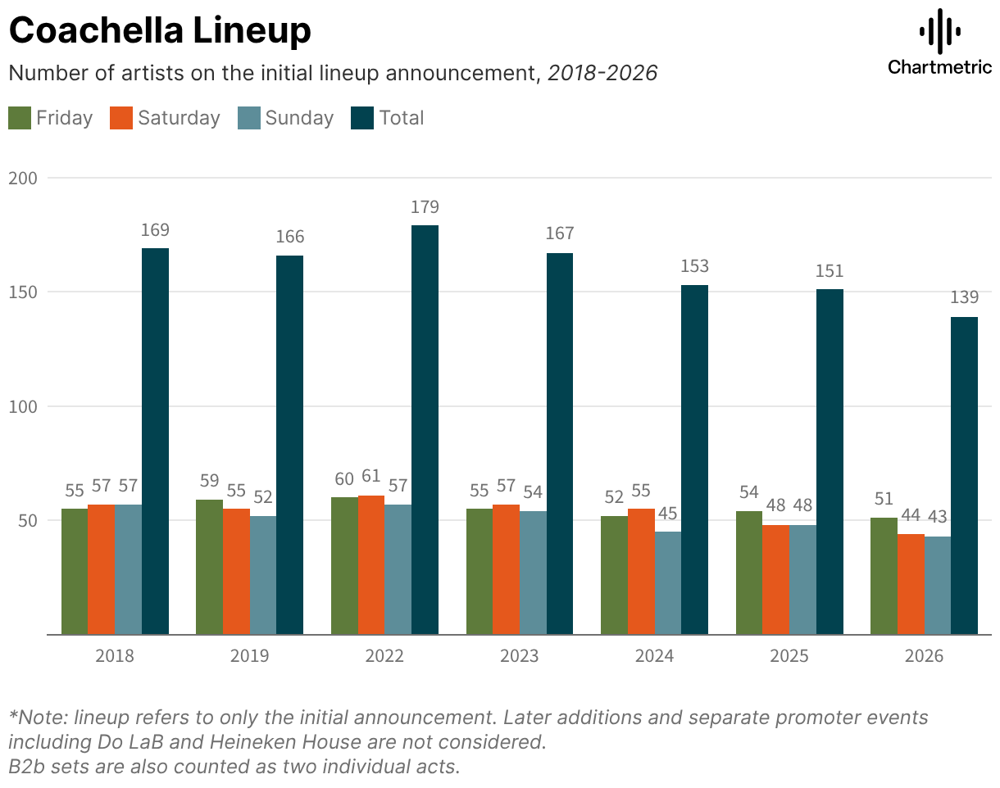
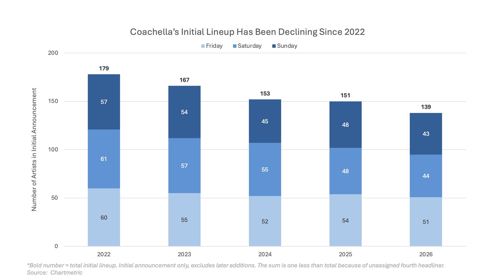
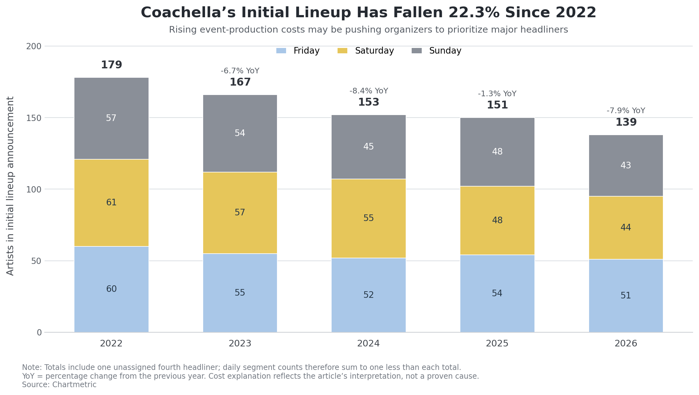

| [home page](https://akorlipara.github.io/ashwitha-dataviz-porfolio/) | [data viz examples](dataviz-examples) | [critique by design](critique-by-design) | [final project I](final-project-part-one) | [final project II](final-project-part-two) | [final project III](final-project-part-three) |

# Coachella Lineup Makeover Monday Redesign 
Text here...

_For each step below, you should document your progress as you move forward.  In terms of tone, think of the writeup as though you're keeping journal of your step-by-step process.   You should include a any insights you gained from the critique method, and what it led you to think about when considering the redesign.  You should talk about how you moved next to the sketches, and any insights you gleaned from your user feedback.  Document what you changed based on the user feedback in your redesign.  Finally, talk about what your redesigned data visualization shows, why you selected the data visualization you did, and what you attempted to show or do differently._

_You can include screenshots, sketches or other artifacts with your narrative to help tell the story of how you moved through the process.  Again, make sure to avoid including any personally identifying information about your interviewees (don't list full names, etc.).  While this template serves as a guide, make sure to reference the assignment writeup on Canvas for the official guidance.  This template does not include all guidance mentioned on the assignment page._

## Step one: the visualization

[Link to Source](https://makeovermonday.vercel.app/dataset/test-week)

I originally chose this data visualization because I love music and closely follow Coachella every year, so this data was genuinely interesting to me. After more investigation of the data visual and reading the source article, it became evident to me that there was room for improvement. The main concern I had with the graph after spending more time with it was that it was not highlighting what the focus of the article was, which is that the number of artists in the initial announcement has been decreasing since 2022. 

## Step two: the critique
**Usefulness**: 7,
**Completeness**: 5,
**Perceptibility**: 7,
**Truthfulness**: 8,
**Intuitiveness**: 8,
**Aesthetics**: 7,
**Engagement**: 5,

**Initial Observations**: The first thing that stood out to me when looking at the graph were the bars, because the colors used were pretty vibrant. Then I noticed the numbers above each bar, which led me to read the title to understand those values. Overall, the graph was not hard to understand, but definitely felt busy with all the different bars, numbers, and colors. 

**What Worked Well**: The first aspect that worked well was truthfulness. I gave this visualization a score of 8 because it accurately represents the data that it was trying to show through the graph, which is the number of artists on each day of Coachella weekend. Additionally, they included a footnote that indicated that this data is only representative of the initial announcement and that later additions would not be considered. Next I gave this visualization a score of 8 for intuitiveness because I thought that the data represented through the graph was easy to observe and understand. This is because they provided a subtitle to clearly explain what they were showing, which is the ‘Number of artists on the initial lineup announcement, 2018-2026’. Additionally, they had a key that clearly indicated what each color on the graph corresponds to. They also used 4 contrasting colors (green, orange, light blue, dark green), which made it easy to see that each bar represented something different. Additionally, their axes were easy to understand as an observer because of the subtitle, as it provided the context for the years as the x-axis and the number of artists as the y-axis. Lastly, I gave this visualization a score of 7 for usefulness because the graph is relevant for the intended audience (labels, managers, and artists).

**What Didn’t Work Well**: The first aspect that I think needs improvement is completeness. After reading the source article, I believe that this visualization does not clearly tell the observer the story the creator is trying to show, which is the trend that the number of artists has been decreasing since 2022. Additionally, while having the footnote is good for transparency, it also results in an incomplete representation. Next I gave engagement a score of 5 for similar reasons pertaining to the intent of the visualization. For example, the graph's title is “Coachella Lineup” which does not show the observer anything regarding the declining trend in performing artists. This is the key takeaway from the source article and not clearly understood unless an observer searches for it. Next I took some points away from truthfulness because the sums do not add up to the total. For example, in 2022 if you add up the bars from Friday through Sunday you get a total of 178 not 179. While the extra performer is explained in the article, that is not explicitly stated so an observer who was just looking at the graph would not know that information. Additionally, the graph skips over 2020 and 2021 due to Covid but that is also not shown in the graph. Next, I gave perceptibility a score of 7 because the bars were easy to read and the numbers were accurate. However, I felt like having 4 bars made it feel a bit crowded and harder to follow the trend. Finally, I gave aesthetics a score of 7. This is because while I like certain aspects of the graph such as their key and numbers above each bar for clearness, having the four bars per year overcrowds the space. 

**Primary Audience**: The primary audience for this data visualization are labels, managers, and artists, as those are the users of the Chartmetric platform. These individuals use Chartmetric to track and compare music performance globally. Overall, I do think that this visualization is effective for reaching that audience with some gaps. The strengths of this visualization are with the truthfulness, intuitiveness, and usefulness. These entities are looking for numbers, which this graph showcases in a truthful manner when paired with the footnote and source article. However, their shortcomings are with the completeness and engagement. These gaps come mainly from the fact that the graph does not focus on clearly showcasing the key takeaway which is the trend of decreasing lineups. Unclear representation of the intent, leads to an incomplete visualization that has low engagement. This is important given the audience because they likely are aware of the numbers, and likely want to focus more on the trend with the numbers then what the numbers are themself.

**Redesign Ideas**: For this redesign I want to focus on improving the completeness of the data visualization to make the intent more clear to an observer. My first idea was to go from a bar graph to a stacked bar graph, as it can showcase the downward trend while also making the graph less crowded. Next, I want to improve the engagement by changing the title to something that highlights the intent of the visual more effectively. For example, I would change it to “Coachella’s Initial Lineup Has Been Declining Since 2022”. To improve the truthfulness and completeness of the visualization I would showcase only from 2022 onwards on the graph (to avoid confusion about 2020 and 2021), as well as add to the footnote about the fourth unassigned headliner. 

**Critique Method Evaluation**: I really enjoyed using this method when doing my critique because it made me think about very specific criteria. For my critique specifically, I was able to identify where the graph was successful, such as with truthfulness, intuitiveness, and usefulness. Likewise, I was able to also identify where the graph had gaps, such as with engagement, completeness, and aesthetics. I also liked identifying the primary audience, because it got me thinking about what they would want to get out of looking at this visualization. Therefore, compared to Good Charts I felt like this method was more of a checklist of what a final solution should look like. With Good Charts, it felt like the process started from first understanding the intent, whereas I identified that as a shortcoming when I was evaluating the different criteria using this method. One thing I felt like was missing was a criteria or aspect of this method that specifically addressed the intent of the graph, as this was a big flaw of my data visualization.

## Step three: Sketch a solution

## Step four: Test the solution
**Questions Asked:** 

- What do you think this graph is about/main takeaway you get from it?

- Did anything stand out or surprise/confuse you?

- Who do you think this was made for?

- Is there anything you would change or do differently?

**Results:**

<ins>Interview #1: Student MISM'27</ins>
- I think this makes the artist lineup look like it's declining, but I would say it's more of a minor decrease than a major drop.
- I think Sunday looks more dense, probably because of the colour scheme.
- I think this is probably meant for an article explaining the current state of the art industry to the general public. It gives people a better idea of what's going on in the industry without making the information too complicated.
- I would honestly leave this as is. I think it looks pretty nice overall, and I don't really see anything that needs to be changed. 

<ins>Interview #2: Student MAM'28</ins>
- The graph communicates the number of artists that were announced for the initial Coachella lineup from 2022-2026, breaking down each year into the number of initial lineup artists into Friday, Saturday and Sunday. The graph shows a minor decrease over the span of the first 4 years, with a more significant decrease in 2026.
- I’m surprised that there is such a distinct decrease in the number of artists in 2026, while the decrease from 2022-2025 was less significant. I wonder if there is a particular reason that explains this detail.
- I think the intended audience is for artists or artist managers to quickly explain how the scope of the event has changed in the past 5 years. It might also provide some good information for audiences so they can understand the number of artists they can expect for the coming event.
- I would change the color scheme. Due to the bold color of Sunday, my eyes are immediately drawn to those portions of the graph which makes me assume that Sunday has the highest number of artists in the initial lineup announcement. I would also include the percentage decrease somewhere so that we can quickly identify if the decreases are linear or exponential. I would also maybe want to see a reason as to why this is occurring since these decreases in artist lineup to live event culture provides information to artists and entertainment managers on what to expect for other live events moving forward.

**Synthesis:**

<ins>Patterns/Similarities:</ins> The first pattern that I noticed was that both interviewers pointed out that due to the color scheme Sunday stood out to them. Another pattern I noticed was that they both pointed out that they thought the decline was minor. Finally, both interviewees were able to easily understand what I was trying to portray in the graph. 

<ins>Differences:</ins> The first interviewee was a more casual observer, and therefore was satisfied with my original makeover. However, interviewee two was more well versed in this industry because they are an Arts Management major. Therefore, interviewee two asked more questions regarding why this was happening. Additionally, this interviewee provided some good suggestions for changes I could make, such as showing the percentage decrease. 

<ins>What I Learned:</ins> From these interviews, I learned that the color scheme I chose was confusing because the darkest blue stuck out. Additionally, I learned that I was not effectively highlighting the decline because interviewee two thought that there was a more significant decrease in 2026 which is not supported by the data. Lastly, I learned that I was missing the “why” which is really important to communicate given the needs of the primary audience. 

<ins>Design Changes:</ins> The first design change that I want to make is showing the rate of change, to clearly show the percentage in decline year to year. Corresponding to that, I want to change the title to include a percentage decrease so that it is clear to the observer. Next, I want to change the color scheme to blue, yellow, and gray so that Sunday no longer stands out. I chose these colors because they are color blind safe. Finally, I want to add a subtitle to indicate what the article infers is the cause behind this decrease, which is that costs are increasing. The article discusses how event production has become more expensive and therefore to mitigate this Coachella may be investing in big headliners in order to profit off of ticket sales. Therefore, this leaves them with less money to spend on booking other artists.

## Step five: build the solution

_Include and describe your final solution here. It's also a good idea to summarize your thoughts on the process overall. When you're done with the assignment, this page should all the items mentioned in the assignment page on Canvas(a link or screenshot of the original data visualization, documentation explaining your process, a summary of your wireframes and user feedback, your final, redesigned data visualization, etc.)._

<ins>Summary:</ins> Overall I think that this process worked successfully in redesigning this data visualization. The individual critique set me up well for creating my initial sketch by having me go through many criteria, and see what needed to be changed. Next, I would say the interviews were a crucial element in my final redesign solution, as I was able to get suggestions of where my updated redesign was still lacking. The feedback I got, especially from the Arts Management student, was highly valuable and allowed me to develop a final solution that is much clearer and cohesive to an observer. 

## References
Makeover Makeup: Original data visualization
Chartmetric: Source article which provided more background information on the data visualization and the intended audience

## AI acknowledgements
ChatGPT: CMU approved GenAI tool used to make my final solution; also used it when brainstorming my sketch + understanding the source article.  

