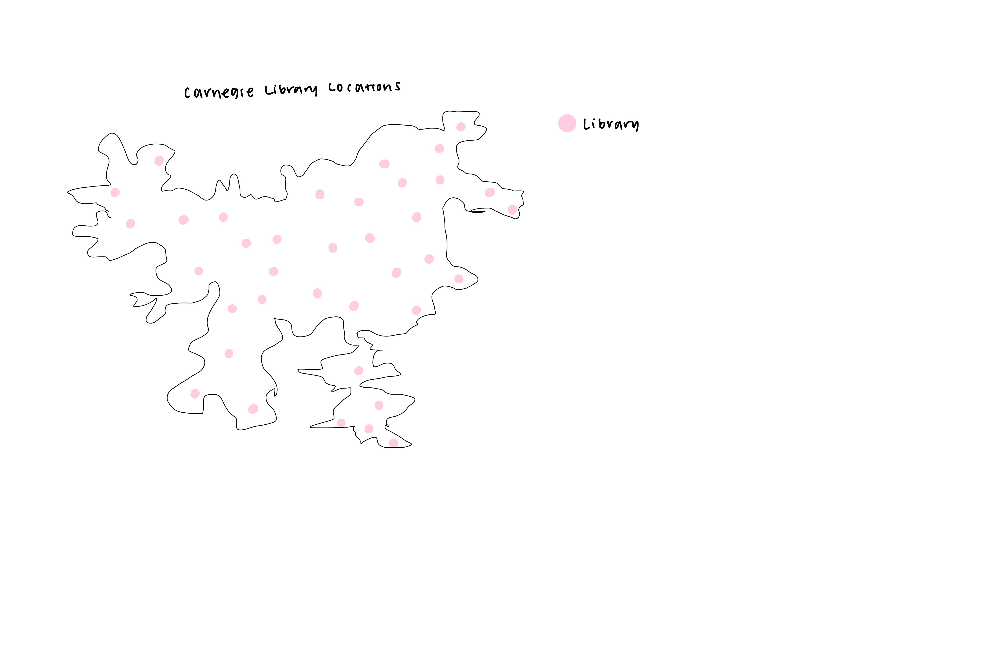
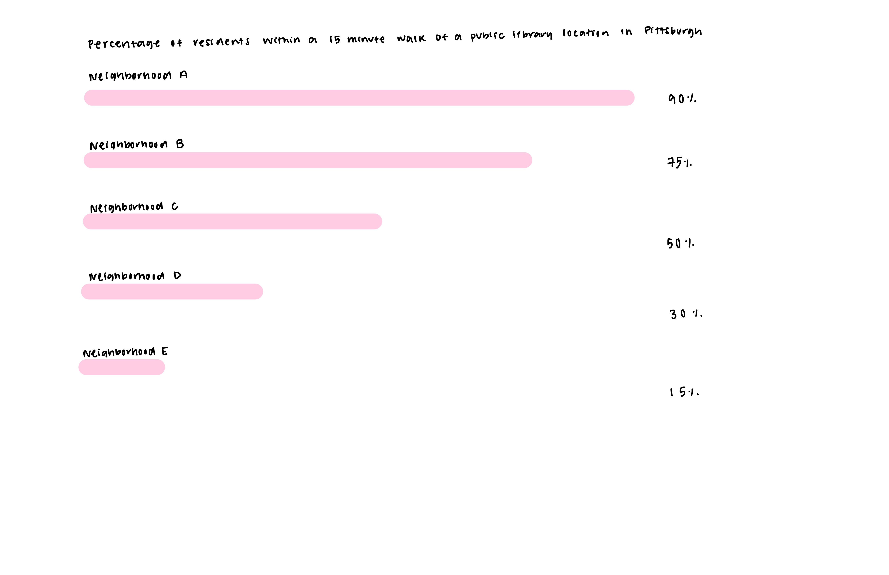
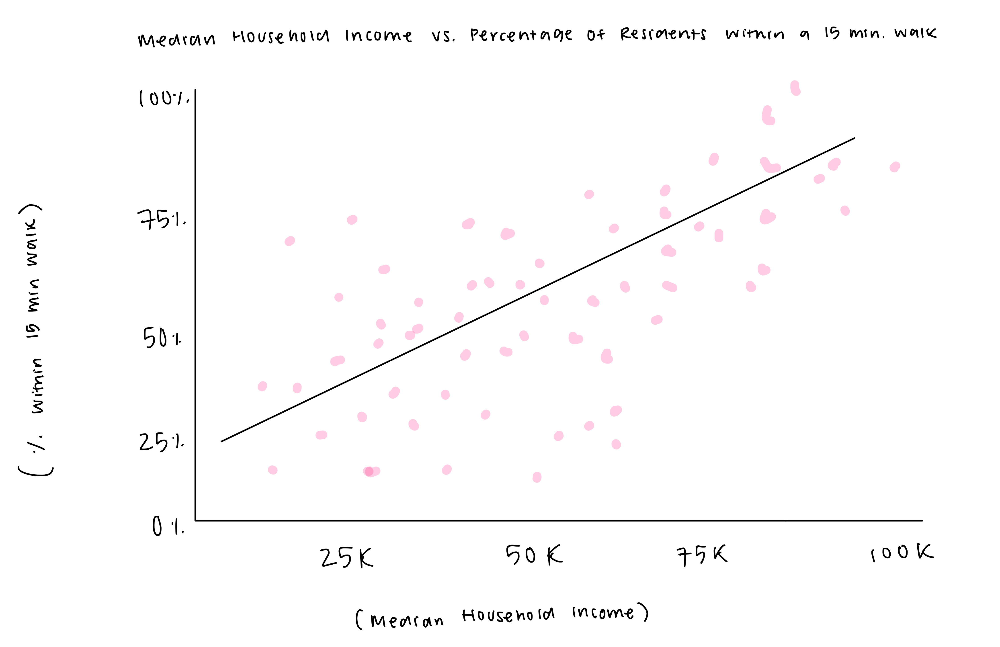
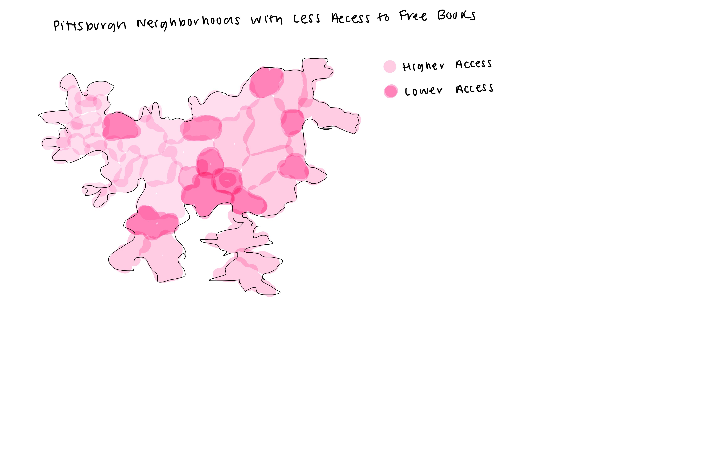

| [home page](https://akorlipara.github.io/ashwitha-dataviz-porfolio/) | [data viz examples](dataviz-examples) | [critique by design](critique-by-design) | [final project I](final-project-part-one) | [final project II](final-project-part-two) | [final project III](final-project-part-three) |

# Outline

**High-Level Summary:**
While access to books is critical to the success of one’s learning and growth, not every community has the same access to free reading materials. Public libraries serve as resources for getting books without a cost, but their availability varies geographically. For my project I want to explore which Pittsburgh residents have easy access to free books and which neighborhoods have fewer opportunities. 

I plan to map Pittsburgh public libraries, and compare their geographic locations with demographic information of neighborhoods. For this project, I specifically want to look into attributes such as population density, income, and age. Additionally, I want to measure accessibility by how walkable these resources are to residents. I plan to compare the percentages of residents in different neighborhoods who are less than a 15 minute walk from one of these resources. By examining where these resources are concentrated and their accessibility to residents, I hope to identify which communities are being underserved. 

Ultimately the story I want to tell through this project is regarding the relationship between geography and accessibility to literary resources. From my visualization, I hope observers are able to identify which neighborhoods have convenient access to free reading materials and which ones do not. The overall goal is to highlight overlooked communities facing educational inequity and encourage making free books more accessible for everyone.

**Project Structure:**

<ins>One Sentence Summary:</ins> Using public library locations and neighborhood demographic data, I will investigate whether Pittsburgh residents have equal access to free books and identify which communities may be left out. 

**Setup:** Pittsburgh has public libraries, which serve as a free book resource for residents.

<ins>Purpose:</ins> Explain the background context for the project and introduce the central question 
- Introduce free book resources for Pittsburgh residents as public libraries
- Explain why access to books matters → educational, learning, literacy
- Establish Pittsburgh as the geographic focus of the project
- Introduce the question of if all residents have equal access to these resources

<ins>Hope to Achieve:</ins> I hope to establish the idea that while free book resources exist in Pittsburgh, their presence does not establish if they are conveniently accessible to all residents.  

**Conflict:** Just because these resources are present does not mean they are equally accessible to all Pittsburgh residents. 

<ins>Purpose:</ins> Dive deeper into the story I am trying to tell with my project, which is to identify which Pittsburgh residents have access to these resources and which neighborhoods have less opportunities. I hope to uncover patterns behind this difference in accessibility to gain a better understanding behind the gap. 

<ins>Part 1:</ins> Where are these resources located? 
- Map Carnegie Library of Pittsburgh branches 
- Examine where the resources are concentrated
- Identify neighborhoods with many and few resources
- Visuals: I will create a map of Pittsburgh that showcases neighborhoods within the boundaries and the locations of public libraries. 

<ins>Part 2:</ins> How accessible are these resources across varying neighborhoods?
- Compare the number of resources across Pittsburgh neighborhoods
- Calculate the number of resources per 1000 residents → addresses population differences among these neighborhoods
- Highlight neighbourhoods with high and low accessibility (~15 min walk or less)
- Visuals: I will create a bar chart that shows this neighborhood comparison.

<ins>Part 3:</ins> Does where a resident lives contribute to any limitations? 
- Identify the percentage of residents that live in walking distance to a resource
- Establish a measurement for proximating the distance
- Compare accessibility patterns with neighborhood demographics
- Investigate and identify relationships between demographics + accessibility
- Visuals: I will create a scatter plot that compares accessibility to income

<ins>Hope to Achieve:</ins> I hope the audience will gain a deeper understanding how accessible free books are in Pittsburgh. I hope they are able to gain more insights behind why some neighborhoods have higher accessibility while others have less.

**Resolution:** Identifying and understanding why certain neighborhoods have fewer opportunities, in order to bridge the accessibility gap. 

<ins>Purpose:</ins> Educate the observer based on findings so they are able to work towards helping underserved neighborhoods.
- Summarize key insights regarding resource accessibility and neighborhood demographics
- Highlight neighborhoods with higher accessibility and those with lower
- Hypothesize potential solutions based on findings 

<ins>Visuals:</ins> I will create a map of neighborhoods with less opportunities and showcase where additional resources could be considered. 

<ins>Hope to Achieve:</ins> I hope the audience will have knowledge of not only where the resources are, but who easily have access to them versus who do not and why.

**User Stories:** 
1. As a Pittsburgh resident, I want to know where free book resources are located so I can identify options near my neighborhood.
2. As a Pittsburgh community member, I want to better understand neighborhoods with less free book resources so I can identify where future resources should be available.
   
## Initial sketches
> Visual #1: 

> Visual #2:

> Visual #3:

> Visual #4:

# The data 

| Name | URL | Source |
|------|-----|-------------|
| Pittsburgh Public Library Locations     | https://data.wprdc.org/dataset/libraries    | Western Pennsylvania Regional Data Center            |
| Pittsburgh Neighborhood Boundaries     | https://data.wprdc.org/dataset/neighborhoods2     | Western Pennsylvania Regional Data Center            |
| Pittsburgh Neighborhood Demographics     | https://data.wprdc.org/dataset/2009-13-and-2019-23-american-community-survey-estimates-for-city-of-pittsburgh-neighborhoods    | Western Pennsylvania Regional Data Center            |

The first dataset I will work with for this project are the locations of public libraries in Pittsburgh. The data source I will be using for public libraries comes from the Western Pennsylvania Regional Data Center. This dataset comes from the Carnegie Library of Pittsburgh branches. 

The next two sets of data I will be working with for this project are related to Pittsburgh neighborhoods. One dataset focuses on the neighborhood boundaries and the other is related to neighborhood demographics. The source for both is the Western Pennsylvania Regional Data Center, with the neighborhood boundaries set coming from the City of Pittsburgh and the demographics set coming from the University of Pittsburgh. 

Overall, for this project I will be incorporating geographic and demographic data in order to examine how accessible free books are for varying neighborhoods in the Pittsburgh area. These datasets will allow me to compare the different neighborhoods in order to identify patterns as to why certain communities are being underserved.

# Method and medium
For my final project I plan to use Tableau to create data visualisations and Shorthand for the storytelling. I plan to use the datasets I collected to create those visualizations to compare the geographic and demographic data in Pittsburgh. Using Shorthand, I plan to incorporate those visualizations along with my story structure in order for the audience to understand and interact with the story I am telling.

## References
Library Locations - CKAN. https://data.wprdc.org/dataset/libraries. Accessed 18 Nov. 2026.
Neighborhoods - CKAN. https://data.wprdc.org/dataset/neighborhoods2. Accessed 18 Nov. 2026.
2009-13 and 2019-23 American Community Survey Estimates for City of Pittsburgh Neighborhoods - CKAN. https://data.wprdc.org/dataset/2009-13-and-2019-23-american-community-survey-estimates-for-city-of-pittsburgh-neighborhoods. Accessed 18 Nov. 2026.

## AI acknowledgements
ChatGPT: Used for brainstorming and flushing out project idea, as well as helped with brainstorming data visuals and searching for datasets.  
